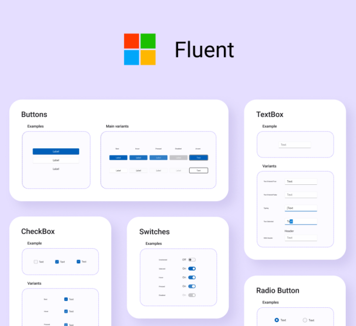

# Fluent-styled controls

<p align="center">
  
</p>

Uno Platform supports control styles conforming to the [Fluent design system](https://www.microsoft.com/design/fluent), the default design system of WinUI.
The details below explain how to use them in your app.

## Enabling Fluent styles

The Uno Platform uses the same mechanism as WinUI to enable Fluent styles: add the `XamlControlsResources` resource dictionary to your application resources inside `App.xaml`. The resources are part of Uno Platform itself, so no additional package is required.

Apps created from the Uno Platform templates already load `XamlControlsResources`. If your app does not, add it to the application resources:

```xml
<Application>
    <Application.Resources>
        <!-- Load WinUI resources -->
        <XamlControlsResources xmlns="using:Microsoft.UI.Xaml.Controls" />
    </Application.Resources>
</Application>
```

Or, if you have other existing application-scope resources, add `XamlControlsResources` at the top (before other resources) as a merged dictionary:

```xml
<Application.Resources>
    <ResourceDictionary>
        <ResourceDictionary.MergedDictionaries>
            <!-- Load WinUI resources -->
            <XamlControlsResources xmlns="using:Microsoft.UI.Xaml.Controls" />
            <!-- Other merged dictionaries here -->
        </ResourceDictionary.MergedDictionaries>
        <!-- Other app resources here -->
    </ResourceDictionary>
</Application.Resources>
```

## FluentTheme: the Uno Themes semantic layer with a Fluent look

`XamlControlsResources` alone gives you the Fluent control styles under their WinUI names (`AccentButtonStyle`, `BodyTextBlockStyle`, …). The `Uno.Fluent.WinUI` package adds the Uno Themes **semantic abstraction layer**: [semantic style keys](semantic-styles.md) like `FilledButtonStyle`, the semantic color palette (`PrimaryBrush`, `OnSurfaceBrush`, …), the semantic typography slots (`DisplayLarge` … `CaptionSmall`), and the [design tokens](design-tokens.md). These keys let shared XAML select a Fluent appearance. Resource overrides have the compatibility limits described below; resolving the same key does not mean every built-in control consumes it.

`FluentTheme` is an *adapter*, not a style library: it ships **no control templates and no implicit styles**. Fluent is already the implicit default of every WinUI / Uno Platform app; the theme only adds:

- **Semantic style aliases** onto the built-in Fluent styles (`FilledButtonStyle` &rarr; `AccentButtonStyle`, `OutlinedTextBoxStyle` &rarr; `DefaultTextBoxStyle`, …) — see the Fluent column in [Semantic Styles](semantic-styles.md).
- **Fluent color values** for the semantic color roles: the accent roles read the system accent (`SystemAccentColor` and its shades — on Windows, the user's real accent color), and the neutral/surface/error roles carry the corresponding Fluent design-token values, per Light/Dark theme. The palette refreshes when the platform reports an accent change and on theme rebuilds.
- **Fluent typography values** for the 19 semantic type slots, using the [Fluent type ramp](https://learn.microsoft.com/en-us/windows/apps/design/style/typography) sizes/weights and the platform-default font (`ContentControlThemeFontFamily`) — no font package is shipped.
- The shared `BaseTheme` machinery: `Space*`/`Radius*` design tokens, `DefaultSpacing`, `DefaultDensity`, `DefaultCornerRadius`, `DefaultFontFamily`, [seed colors](seed-colors.md) (opt-in), color overrides, and hot reload.

### Installation

In a single-project app, add `FluentTheme` to the list of `UnoFeatures` in your project file (`PROJECT_NAME.csproj`):

```xml
<UnoFeatures>FluentTheme</UnoFeatures>
```

Otherwise, add a reference to the `Uno.Fluent.WinUI` NuGet package to your application project.

A runnable showcase lives in the repository at `src/samples/FluentSampleApp` — the shared Uno Themes sample gallery rendered through `FluentTheme`: Fluent sample tabs for every control the semantic layer covers, plus the Overview, Semantic Styling, Colors, Seed Color and Design Tokens pages.

### App.xaml setup

Merge `FluentTheme` **after** `XamlControlsResources`:

```xml
<Application.Resources>
    <ResourceDictionary>
        <ResourceDictionary.MergedDictionaries>
            <!-- Load WinUI resources — MUST come first -->
            <XamlControlsResources xmlns="using:Microsoft.UI.Xaml.Controls" />

            <!-- Load the Uno Themes semantic layer mapped onto Fluent -->
            <FluentTheme xmlns="using:Uno.Fluent" />

            <!-- Other merged dictionaries here -->
        </ResourceDictionary.MergedDictionaries>
    </ResourceDictionary>
</Application.Resources>
```

> [!IMPORTANT]
> The ordering requirement is load-bearing: `FluentTheme`'s semantic aliases and color mappings resolve against the resources `XamlControlsResources` provides. When the Fluent tokens are unreachable (for example, the dictionaries are merged in the wrong order), the semantic colors keep the Uno Themes shared defaults and a warning is logged — theme initialization never throws.

### Behavior notes

- **High contrast limitation**: `FluentTheme` currently defines its semantic palette and accent mapping for Light/Default only. In Windows high contrast mode, semantic resources can retain dark-theme values instead of following the system colors, and generated accent overrides from a seed or `PrimaryColor` can also override built-in controls' high contrast resources. High contrast support for these mappings is incomplete.
- **Interaction states**: the semantic layer encodes interaction states as opacity variants of the rest color (`PrimaryHoverBrush` = `PrimaryColor` at hover opacity), while Fluent uses discrete per-state fill colors inside its templates. Under `FluentTheme`, built-in controls keep Fluent's own state behavior (correct by definition); app XAML that uses semantic *state* brushes gets opacity-derived variants of the Fluent rest colors — visually consistent, but not token-identical to Fluent's hover/pressed colors.
- **Materials**: Mica and Acrylic are not applied by the theme. The semantic surface roles map to Fluent's solid-color fallback tokens (`SolidBackgroundFillColor*`); apps can layer materials themselves where supported.
- **Seed colors**: like all Uno Themes, setting `Colors.PrimarySeed` generates a semantic palette from your brand color ([seed colors](seed-colors.md)). The generation mode is the shared `SeedColorMode` default (`Fidelity`: the seed's chroma is preserved and the light `PrimaryColor` is the seed verbatim); the seed also recolors the built-in Fluent controls through the same mode ([seed → accent cascade](seed-colors.md#fluenttheme-seed--accent-cascade)). Without a seed, the palette follows the platform accent (from `XamlControlsResources`, and the system accent on Windows) and Fluent neutrals; to brand the theme, use a seed or a `PrimaryColor` override rather than redefining `SystemAccentColor`.
- **Lightweight styling**: built-in controls keep the WinUI templates, so you lightweight-style them with Fluent's own per-control keys (`AccentButtonBackground`, `TextControlForeground`, …), exactly as in a plain WinUI app. The semantic per-control keys of Material and Simple (`FilledButtonBackground`, …) have no effect under `FluentTheme`. See [Lightweight Styling — Fluent theme](lightweight-styling.md#fluent-theme).
- **Design tokens reach the built-in controls**: the Fluent templates read `ControlCornerRadius` / `OverlayCornerRadius` and `ContentControlThemeFontFamily`, so a `DefaultCornerRadius` or `DefaultFontFamily` set on `FluentTheme` re-points those platform tokens and stock Fluent controls follow (buttons, text boxes, flyouts, …), as they do under Material and Simple. `OverlayCornerRadius` is twice the base unit (the `Radius200` token). Left unset, the platform values stand. A handful of templates read the corner radius with `StaticResource` and keep the platform value (CalendarView, RadioButton, Slider, ToggleSwitch, PagerControl, ColorPicker); `DefaultSpacing` / `DefaultDensity` have no effect on Fluent templates (their metrics are baked in).
- **Semantic Primary vs. accent fill**: with the platform accent or a seed, Fluent paints accent controls with a *shade* of the accent (`Dark1` in the light theme, `Light2` in the dark theme), while the semantic `PrimaryBrush` is the accent itself in the light theme. A `FilledButtonStyle` button therefore renders darker than a surface painted with `PrimaryBrush` in the light theme; in the dark theme the two coincide. An explicit `PrimaryColor` supplied through `Colors.OverrideDictionary` instead becomes the accent fill verbatim for its appearance.

### Override compatibility

Use the shared override channels for semantic resources, with these Fluent mappings and scope rules:

- **Color roles and brushes**: `PrimaryColor` (or a solid `PrimaryBrush`) drives the built-in accent controls, and `OnPrimaryColor` (or a solid `OnPrimaryBrush`) the text on them, from any color-override channel: the constructor's `colorOverride`, `Colors.OverrideDictionary` / `Colors.OverrideSource`, or the obsolete `ColorOverride*` properties. Other semantic overrides change semantic resource lookups only.
- **Dictionary structure**: override entries may be flat, in the `Light` / `Dark` / `Default` theme dictionaries, or in nested `MergedDictionaries`, following the native lookup order.
- **Scope and variants**: the semantic per-control keys (`FilledButtonBackground`, …) are not read by the built-in templates; use the native Fluent keys, at any scope. Filled tonal and elevated buttons share the standard Fluent button, so they cannot be customized independently. See [Lightweight Styling](lightweight-styling.md#fluent-theme).
- **Typography**: set the theme's `DefaultFontFamily` property to change every semantic font slot and the built-in control font. A dictionary override of the `DefaultFontFamily` resource alone does not cascade under Fluent: its slot aliases target `ContentControlThemeFontFamily` directly. Use concrete slot keys such as `BodyMediumFontFamily` in `FontOverrideDictionary` for individual typography overrides.
- **Existing controls**: built-in controls rendered while a seed or `PrimaryColor` override is active update in place when it changes or clears. Controls rendered before the first seed or override was set keep the platform accent until they are re-created.
