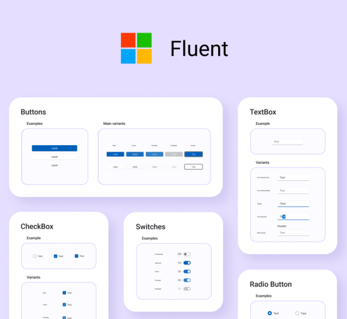

# Fluent-styled controls

<p align="center">
  
</p>

Uno Platform supports control styles conforming to the [Fluent design system](https://www.microsoft.com/design/fluent), the default design system of WinUI.
The details below explain how to use them in your app.

## Enabling Fluent styles

The Uno Platform uses the same mechanism as WinUI to enable Fluent styles: add the `XamlControlsResources` resource dictionary to your application resources inside `App.xaml`. The resources are part of Uno Platform itself, so no additional package is required.

Apps created from the Uno Platform templates already load `XamlControlsResources`. If your app does not, add it to the application resources:

```xml
<Application>
    <Application.Resources>
        <!-- Load WinUI resources -->
        <XamlControlsResources xmlns="using:Microsoft.UI.Xaml.Controls" />
    </Application.Resources>
</Application>
```

Or, if you have other existing application-scope resources, add `XamlControlsResources` at the top (before other resources) as a merged dictionary:

```xml
<Application.Resources>
    <ResourceDictionary>
        <ResourceDictionary.MergedDictionaries>
            <!-- Load WinUI resources -->
            <XamlControlsResources xmlns="using:Microsoft.UI.Xaml.Controls" />
            <!-- Other merged dictionaries here -->
        </ResourceDictionary.MergedDictionaries>
        <!-- Other app resources here -->
    </ResourceDictionary>
</Application.Resources>
```
